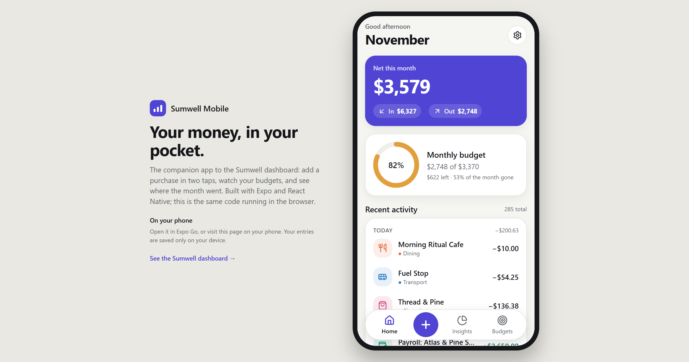
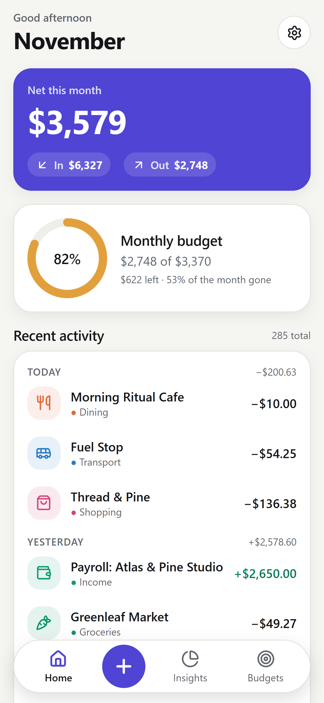
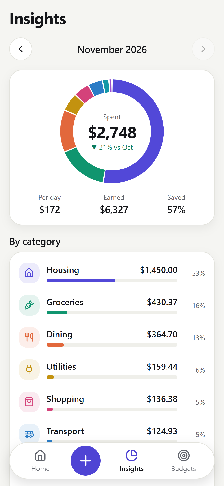
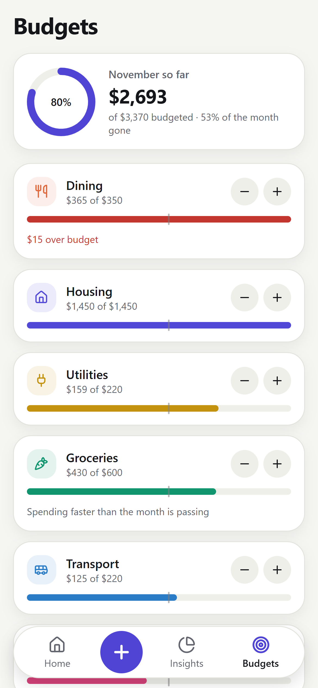
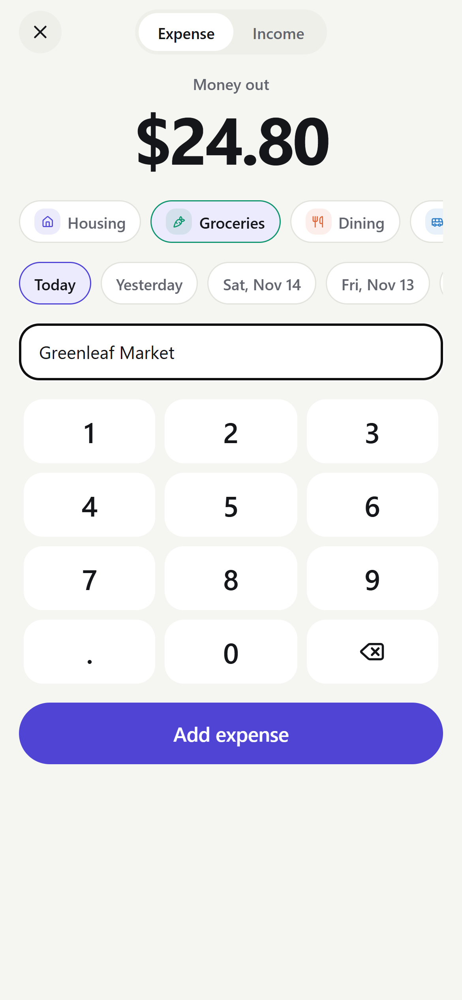
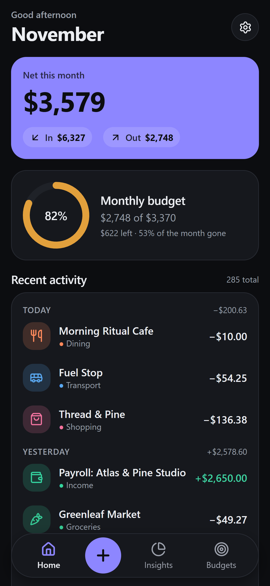
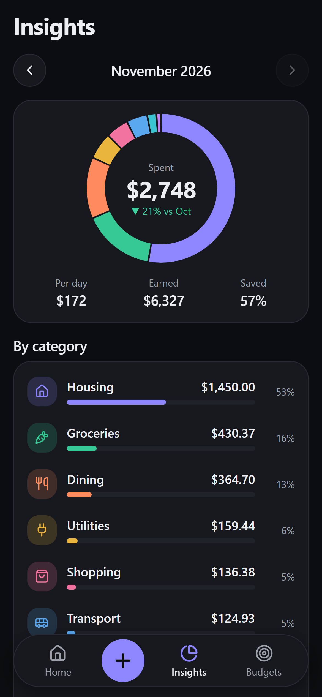
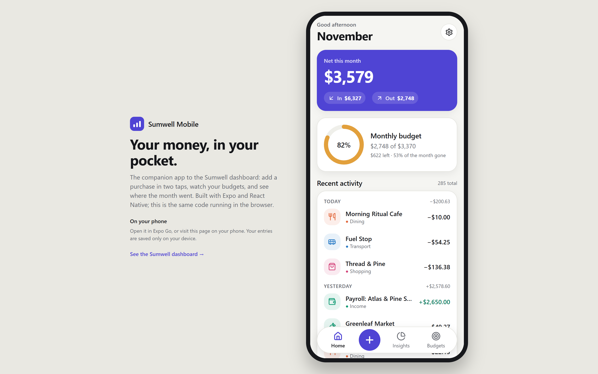

# Sumwell Mobile: an Expo companion app

**Web demo:** https://sumwell-mobile.vercel.app · **Phone:** open in Expo Go (see below)

The pocket companion to the [Sumwell dashboard](https://sumwell-finance-dashboard.vercel.app). Add a purchase in two taps, keep an eye on your budgets, and see where the month went. Built once with Expo and React Native, it runs on iOS, Android and the web from the same code.

> A portfolio project. Merchants and amounts in the demo history are generated; your own entries are saved only on your device.



## Screenshots

| Home | Insights | Budgets | Quick add |
|---|---|---|---|
|  |  |  |  |

| Dark mode | Dark insights | Web demo |
|---|---|---|
|  |  |  |

The case study is in [`docs/case-study.md`](docs/case-study.md).

## Features
- **Home:** net for the month, money in and out, a budget ring that turns amber when you're spending faster than the month is passing, and recent activity grouped by day.
- **Quick add:** a big amount with its own number pad (no keyboard covering the screen), expense or income, category chips, a note, and the last week of dates.
  - It rejects a third decimal place and amounts that are too long.
  - Haptic taps on iOS and Android.
- **Edit and delete:** tap any transaction; deleting asks for confirmation.
- **Insights:** a category donut with change vs last month, per-day spend, savings rate, a category breakdown and six months of income vs spending. You can browse back through earlier months.
- **Budgets:** progress bars with an even-pace marker, ±$25 steppers, and one tap to budget a new category.
- **Your data stays on the device:** saved with AsyncStorage. The first launch loads a realistic demo history, and Settings can reload it or start empty.
- **Dark mode** that follows the system, on every platform.
- **Web demo:** on a desktop browser the app appears in a phone frame next to a short intro; on a phone browser it's full screen.

## Built with
Expo SDK 58 · React Native 0.88 · Expo Router (stack + tabs, modal sheets) · TypeScript · react-native-svg (ring, donut and bar charts) · AsyncStorage · expo-haptics · Lucide icons · static web export on Vercel. Everything used is available in Expo Go, so no custom native build is needed.

## Decisions worth noting
- **One custom tab bar everywhere.** It's a floating pill with a center add button, built on Expo Router's tabs, so iOS, Android and the web look and behave the same, and the web build can stand in for testing.
- **Demo data generated on the device,** ending today: pay on the 1st and 15th, rent on the 1st, more dining on weekends. A tiny seeded random generator keeps it repeatable without shipping a data library.
- **Icons imported one by one.** Importing from `lucide-react-native` pulled in all ~4,700 icons because Metro doesn't tree-shake. Per-icon imports cut the shared web bundle from 2.3 MB to 133 KB.
- **Hydration-safe theming on the web.** The static HTML can't know the visitor's color scheme or screen size, so the first render matches it, then switches. Otherwise dark mode left some light surfaces behind, and the phone frame caused a hydration error.
- **No rotation transforms in SVG.** The ring is drawn as an explicit arc from 12 o'clock, because rotated SVG groups render differently on the web.

## Testing
- **Browser tests on the web build (phone size, headless Chrome), 25 of 25 passing:**
  - **Navigation:** the tabs, browsing months, and the "next month" limit
  - **Transactions:** keypad rules, adding an expense (and its effect on net), editing, deleting with confirmation, and income
  - **Saved data:** survives a reload
  - **Budgets:** steppers, adding a category, and saving
  - **Settings:** start fresh and reload the demo
  - **Layout and theme:** no sideways scroll, dark mode with no light surfaces left, the desktop phone frame, and no console errors
- **`expo-doctor`:** 20/20 checks pass. TypeScript and ESLint are clean.

## Lighthouse (web demo)
| | Performance | Accessibility | Best Practices | SEO |
|---|---|---|---|---|
| Desktop | 98 | 100 | 100 | 100 |
| Mobile | 72–77 | 100 | 100 | 100 |

Mobile performance on the web is held back by React Native for Web's runtime (about 1.1 MB). On phones, the app runs natively through Expo Go.

## Run it
```bash
npm install
npx expo start          # press w for the web, or scan the QR code with Expo Go
npm run build:web       # static web export into dist/
```

### Open on your phone with Expo Go
1. Install **Expo Go** from the App Store or Google Play.
2. Either:
   - run `npx expo start` on your computer and scan the QR code (same Wi-Fi, or add `--tunnel`), or
   - publish an update with Expo Update (`npx eas-cli@latest update`) after signing in to your Expo account, and share its link.

## Project structure
```
src/
  app/
    (tabs)/          # Home, Insights, Budgets + custom tab bar layout
    add.tsx          # add / edit sheet (?id=… edits)
    settings.tsx     # demo data, start fresh, about
    _layout.tsx      # theme, data provider, stack with modal sheets
    +html.tsx        # web HTML shell (title, social tags, no dark flash)
  components/        # ui kit, charts, tab bar, transaction row, web phone frame
  lib/               # store (AsyncStorage), demo generator, analytics, theme, icons
assets/images/       # app icon, adaptive icon, splash
docs/                # thumbnail, screenshots, case study
```

## What I learned
- **Expo moves fast.** SDK 58's Expo Router includes its own tab and stack navigators with a different tab bar API, and custom HTML needs server document nodes. Reading the versioned docs saved a lot of guesswork.
- **Metro doesn't tree-shake by default,** so one convenient import can add megabytes.
- **Static rendering and client-only facts don't mix.** Color scheme and window size need a hydration-safe first render.
- **Design for thumbs.** A custom number pad, big targets and a center add button made "two taps to log a coffee" real.

_Edit these in your own words before sharing._
