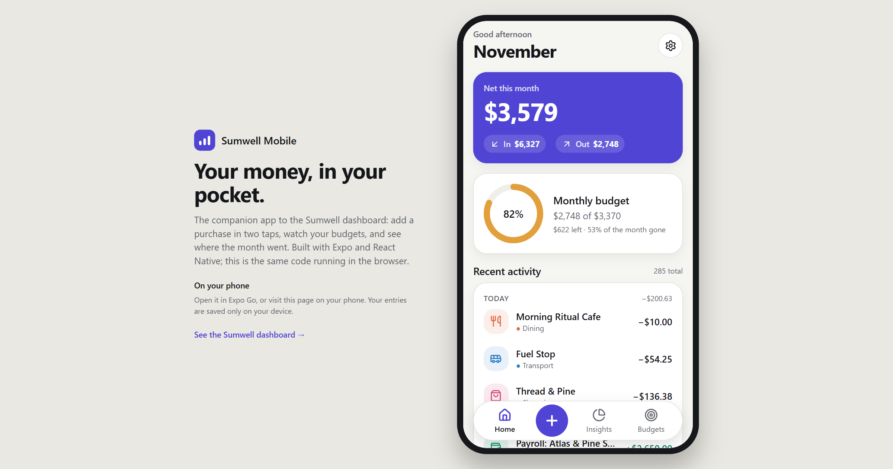
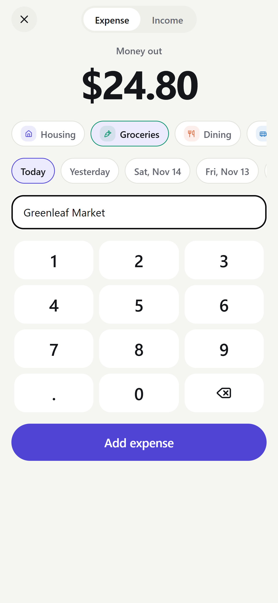
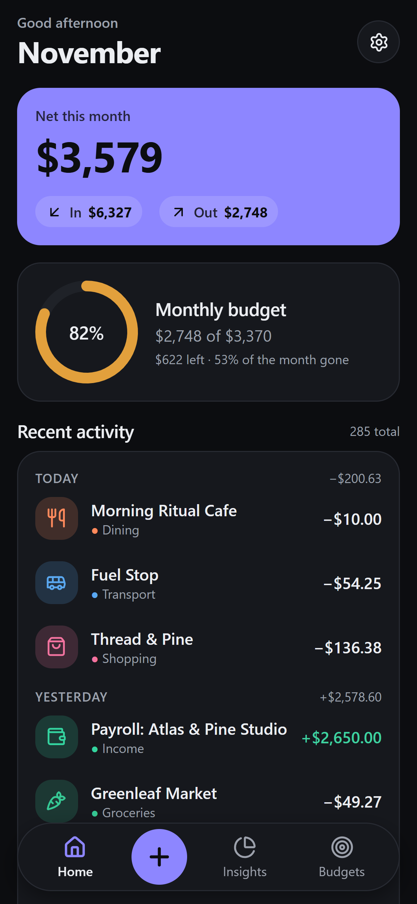
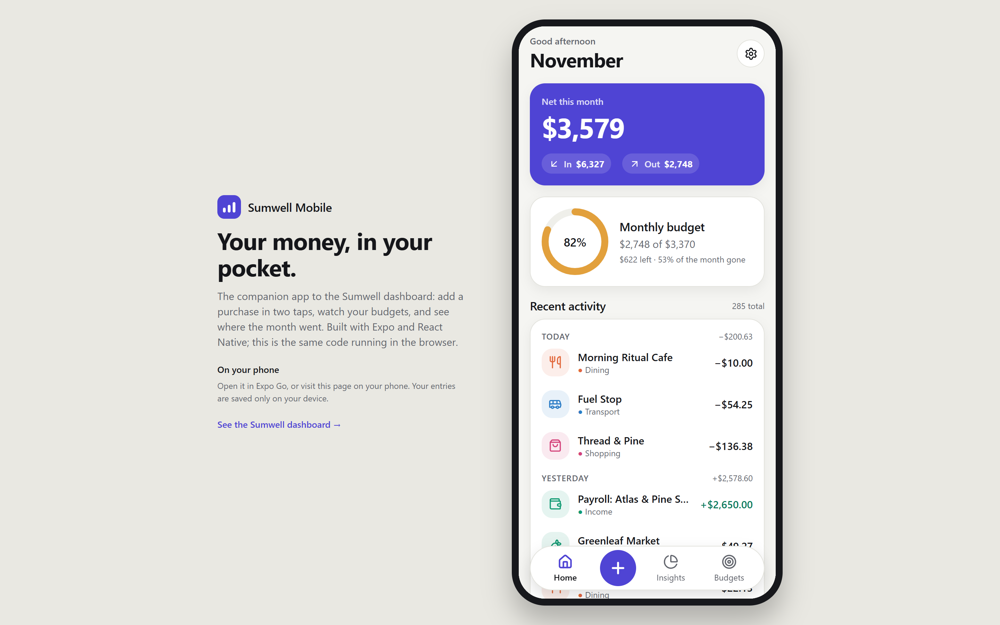

# Sumwell Mobile: case study

**Role:** Design and development (solo)
**Type:** Cross-platform mobile app (iOS, Android, web)
**Stack:** Expo SDK 58, React Native 0.88, Expo Router, TypeScript, react-native-svg, AsyncStorage, expo-haptics, Vercel (web demo)
**Links:** [Web demo](https://sumwell-mobile.vercel.app) · [Code](https://github.com/shervs336/sumwell-mobile) · [Sumwell dashboard](https://sumwell-finance-dashboard.vercel.app)

---

## Short version (for a portfolio card)

> The pocket companion to my Sumwell finance dashboard: log a purchase in two taps, watch budgets fill against the month, and browse insights. One Expo codebase runs on iOS, Android and the web, works with Expo Go, and keeps all data on the device.

---

## Problem

Dashboards are good for reviewing money, but most spending happens away from a desk. Logging a coffee has to take seconds, one-handed, or it doesn't happen. The app also needed to feel native on both phone platforms without maintaining two codebases.

## Approach

- **Thumb-first quick add:**
  - a custom number pad, so the system keyboard never covers the screen
  - category chips, and dates for the last week
  - a center add button that's always reachable
  - haptic confirmation
- **Answers at a glance:**
  - Home shows the month's net, plus a budget ring that changes color when you're ahead of pace.
  - Insights breaks spending down by category and over six months.
- **One codebase:** Expo Router screens, a custom tab bar and SVG charts look the same on iOS, Android and the web, so the web build doubles as a demo and a test target.
- **Local-first:** data is saved with AsyncStorage and seeded with a realistic generated history.

## Key decisions

| Decision | Why |
|---|---|
| Only modules included in Expo Go | Anyone can open the app on a real phone without a custom build. |
| Custom tab bar on Expo Router tabs | Identical behavior on every platform, and a center add button the system tab bars don't offer. |
| Custom number pad instead of a text field | No keyboard jump, enforced money format, bigger targets. |
| Per-icon imports | Metro doesn't tree-shake; the shared web bundle went from 2.3 MB to 133 KB. |
| Hydration-safe scheme and layout on the web | Static HTML can't know dark mode or window size; rendering them after hydration fixed leftover light surfaces and a hydration error. |
| SVG arcs instead of rotated groups | Rotation transforms render differently on web and native. |
| Budget pace ignores fixed bills | Rent on the 1st would otherwise always look "ahead of pace" (same lesson as the dashboard). |

## Testing

- **25 browser tests on the web build at phone size, all passing:**
  - **Navigation:** tabs and browsing months
  - **Transactions:** keypad rules, then add, edit and delete, and income
  - **Saving:** data and budgets survive reloads
  - **Settings:** start fresh and reload the demo
  - **Theme and layout:** dark mode consistency and the desktop frame
  - **Console:** no errors
- **`expo-doctor`:** 20/20 checks pass. TypeScript and ESLint are clean.

## Result

- A working cross-platform app that opens in Expo Go, plus a live web demo.
- **Lighthouse (web demo):** Desktop 98 / 100 / 100 / 100. Mobile 72–77 / 100 / 100 / 100, limited by React Native for Web's runtime.

| Home (dark) | Web demo |
|---|---|
|  |  |

## What I'd do next

- Sync with the Sumwell dashboard (an optional account, so imported bank CSVs appear on the phone).
- Home-screen widgets for budget left this month.
- Recurring transactions and reminders.
